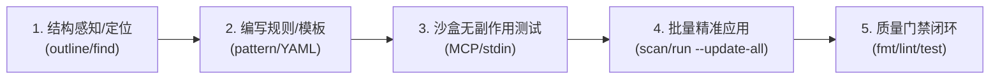

# ast-grep 结构探索与语法级重构规范

本规范固化了跨语言代码库中进行语法级结构探索与安全重构的标准 SOP，明确了 `ast-grep` MCP 工具与 CLI 终端指令的高效协同机制。

---

## 1. 核心原则与三大红线 (Principles & Red Lines)

1. **语法结构重构唯一工具**：所有涉及代码语法结构、函数/方法签名、接口调用迁移、类型重命名、模型定义或导包路径的调整，**强制统一使用 `ast-grep`**。
2. **严禁逐个文件轮询修改**：**严禁针对相同模式的代码使用单文件编辑工具逐个文件手动改写**。凡涉及跨文件或批量代码重构，一律禁止串行手工编辑，必须通过 `ast-grep` 批量精准应用。
3. **严禁正则批量替换代码**：**严禁使用 `sd`、`sed` 或普通正则表达式批量替换代码源文件**（防止破坏 AST 结构、引发换行/嵌套错乱或误伤同名标识符）。文本替换工具仅限用于 Markdown 文档、行内注释与非代码纯文本文件。

---

## 2. 标准重构 5 步闭环 SOP (The 5-Step Pipeline)



### Step 1: 结构感知与模式定位 (Outline & Find)

在修改代码前，优先使用低成本结构化工具探查代码拓扑：

- **符号大纲概览**：

  ```bash
  rtk ast-grep outline <target-file-or-dir>
  ```

- **AST 语法树转储（获取节点精确类型名称）**：
  - MCP 工具：`ast-grep:dump_syntax_tree(code: "func Foo() error { ... }", language: "go")`
- **代码模式探索定位**：
  - MCP 工具：`ast-grep:find_code(pattern: "$OBJ.Call($$$ARGS)", language: "go")`
  - CLI 终端：`rtk ast-grep run --pattern '$OBJ.Call($$$ARGS)' --lang go <search-path>`

### Step 2: 规则设计与改写模板 (Authoring)

- **轻量单行改写**：直接设计 `--pattern` 与 `--rewrite` 表达模板。
- **系统级/关系型改写**：编写 YAML 规则（可保存在 `scratch/rule.yml` 等临时路径）。若使用关系型匹配（`inside` / `has`），**必须显式指定 `stopBy: end`** 以深度遍历子树：

  ```yaml
  id: migrate-call-pattern
  language: go
  rule:
    pattern: s.q.$METHOD($CTX, $$$ARGS)
    inside:
      kind: function_declaration
      stopBy: end
  fix: s.repo.$METHOD($CTX, $$$ARGS)
  ```

### Step 3: 沙盒无副作用验证 (Sandbox Validation)

在应用到真实文件系统前，必须在沙盒中确认匹配度与改写结果，杜绝误伤：

- **MCP 规则验证**：
  - 调用 `ast-grep:test_match_code_rule(code: "target code", yaml: "rule yaml content")`
- **CLI 标准输入验证**：

  ```bash
  echo "sampleCode()" | rtk ast-grep scan --inline-rules "id: t
  language: go
  rule:
    pattern: sampleCode()
  fix: targetCode()" --stdin
  ```

### Step 4: 批量安全执行 (Batch Execution)

经沙盒验证无误后，统一通过 CLI 一键应用到目标目录：

```bash
# 模式快速改写
rtk ast-grep run --pattern '$CALL($CTX, $OLD)' --rewrite '$CALL($CTX, $NEW)' --lang go --update-all <dir>

# 基于 YAML 规则文件批量执行
rtk ast-grep scan --rule scratch/rule.yml --update-all <dir>
```

### Step 5: 后置质量门禁闭环 (Quality Verification)

改写完成后，必须执行工作区标准质量检查闭环：

1. **代码格式化与自动清理**：`just fmt`（或语言对应的格式化工具）。
2. **静态代码检查**：`just lint`，严格保持 0 警告 0 报错。
3. **自动化测试**：运行单元测试与契约测试，确保行为完全保真。

---

## 3. 常用通配符与参数速查 (Cheatsheet)

| 语法 / 参数         | 用途说明                                         | 示例                                                  |
| :------------------ | :----------------------------------------------- | :---------------------------------------------------- |
| `$VAR`              | 匹配单个 AST 节点（变量、标识符、表达式、类型）  | `response.OK(c, $DATA)`                               |
| `$$$ARGS`           | 匹配 0 个或多个 AST 节点序列（实参列表、语句块） | `r.Post($PATH, $$$HANDLERS)`                          |
| `$$$PARAMS`         | 匹配形参列表                                     | `func ($RECV) $NAME($$$PARAMS) error`                 |
| `stopBy: end`       | 关系型嵌套匹配（`inside`/`has`）深度遍历整个子树 | `inside: { kind: function_declaration, stopBy: end }` |
| `--update-all`      | 直接将改写批量应用到磁盘文件（非交互模式）       | `rtk ast-grep scan --rule r.yml --update-all`         |
| `--stdin`           | 从标准输入读取代码片段进行无副作用即时验证       | `echo "..." \| rtk ast-grep scan --stdin`             |
| `--debug-query=cst` | 打印目标模式的具体语法树（定位 `kind` 名称）     | `rtk ast-grep run -p '...' --debug-query=cst`         |
